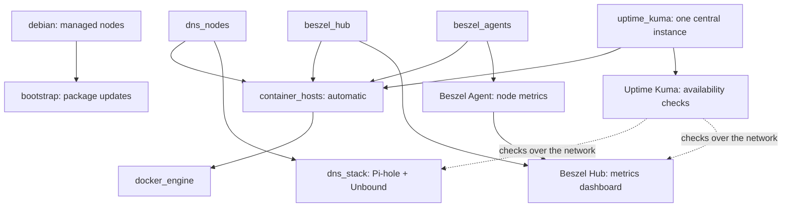

# Home infrastructure

Ansible manages Debian nodes and assigns services through inventory groups.



| Inventory group | Role |
| --- | --- |
| `debian` | Base Debian node setup |
| `dns_nodes` | Pi-hole and Unbound |
| `beszel_hub` | Central Beszel dashboard |
| `beszel_agents` | Beszel metrics agents |
| `uptime_kuma` | One central availability monitor |

Container service groups automatically include their nodes in `container_hosts`,
which installs Docker. Kuma checks selected services over the network; configure
monitors in its web interface.

## Run a deployment

Select an inventory group or machine alias, then choose a service tag:

```sh
ansible-playbook playbooks/site.yml --limit <group-or-alias> --tags <service-tag>
```

For example, deploy the central Kuma instance:

```sh
ansible-playbook playbooks/site.yml --limit uptime_kuma --tags uptime_kuma
```

Tags: `base`, `docker`, `dns`, `beszel_hub`, `beszel_agent`, `uptime_kuma`.
Omit `--limit` and `--tags` to run the full playbook.

## Repository layout

- `inventory/hosts.ini` — node and service assignments.
- `inventory/host_vars/` — connection settings for each node.
- `inventory/group_vars/` — shared variables and encrypted secrets.
- `roles/` — tasks, defaults, and Compose templates for each service.

To add a node, add it to `debian`, set its connection details in `host_vars/`,
then assign it to the required service groups. The private SSH key stays on the
Ansible control machine.
